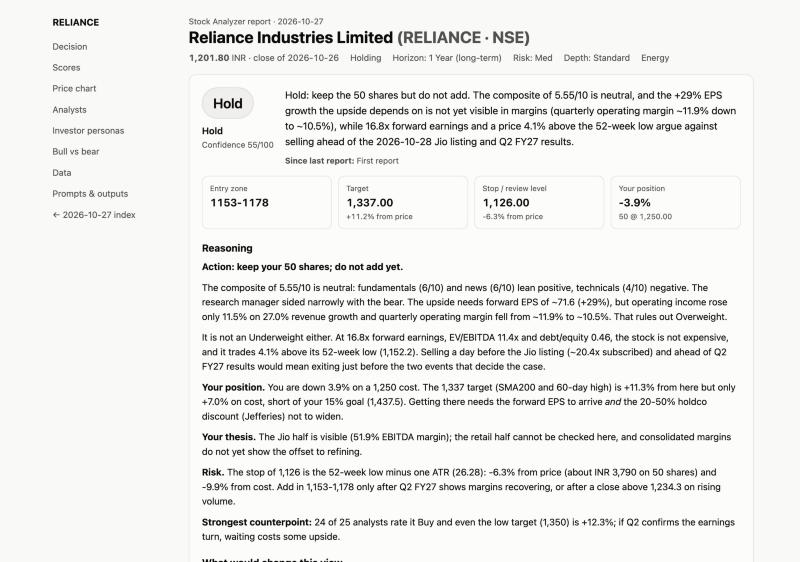

# Stock Analyzer

One Excel workbook for all your stocks (Indian **NSE/BSE** and US **NASDAQ/NYSE**), each with its own investment horizon. Every day an AI research team analyses them **one at a time** and writes an **HTML report for each stock on each date**. Every analysis step runs from its own prompt file, and the exact prompt used is saved next to each report.

It runs in two ways:

- **Claude Code agent** (`/analyze-stocks`): no API key needed. It uses your Claude subscription and any connectors you have (Financial Modeling Prep, Zerodha Kite, web search), and the Claude desktop app's scheduler can run it daily.
- **Standalone script** (`run.py`): calls the Claude API directly, for cron or a server. Needs an Anthropic API key.



> **Research, not advice.** Everything this produces is AI-generated analysis for information only. It can be wrong. It never places trades: a built-in hook blocks every broker order tool.

---

## Contents

1. [What it does](#1-what-it-does)
2. [Prerequisites](#2-prerequisites)
3. [Quick start](#3-quick-start)
4. [The Excel workbook](#4-the-excel-workbook)
5. [Running an analysis](#5-running-an-analysis)
6. [Daily schedule](#6-daily-schedule)
7. [How the analysis works and how to change it](#7-how-the-analysis-works-and-how-to-change-it)
8. [Memory, lessons and the Scorecard](#8-memory-lessons-and-the-scorecard)
9. [2nd opinion: TradingAgents](#9-2nd-opinion-tradingagents)
10. [Folder layout](#10-folder-layout)
11. [Safety](#11-safety)
12. [Troubleshooting](#12-troubleshooting)
13. [Sharing with others](#13-sharing-with-others)
14. [Credits and licences](#14-credits-and-licences)
15. [Disclaimer](#15-disclaimer)

---

## 1. What it does

For every stock row in `stocks.xlsx` it:

1. **Fetches data** through the OpenBB Open Data Platform (Yahoo Finance by default): 2 years of prices, fundamentals, quarterly results, analyst consensus, recent news from Yahoo and Google News, and the market backdrop (NIFTY 50 / India VIX, or S&P 500 / VIX). All indicators (moving averages, RSI, MACD, ATR, drawdown, relative strength and so on) are computed in Python, never by the AI.
2. **Settles past calls.** Once a previous rating's window has passed, it measures the return and alpha vs the benchmark and writes a short lesson for future runs.
3. **Runs a research team**, each member from its own prompt file:
   - 4 analysts: technical, fundamental, news, sentiment
   - investor personas chosen for your horizon: Buffett, Munger, Graham, Lynch, Druckenmiller
   - a bull vs bear debate, judged by a research manager
   - aggressive, conservative and neutral risk reviewers (Deep depth only)
   - a portfolio manager who makes the final call
4. **Gives a 5-tier rating**: Buy / Overweight / Hold / Underweight / Sell, or REVIEW if no clear call. The rating is translated into an action for your position:
   - Holding: Add / Add on dips / Hold / Trim / Exit
   - Watchlist: Buy / Accumulate / Wait / Avoid
   - Plus an entry zone, a target, a stop and "what would change this view".
5. **Writes the report**, `reports/<date>/<TICKER_EXCHANGE>/report.html`, with a day index at `reports/<date>/index.html`. It also logs the result in the workbook.

---

## 2. Prerequisites

| Need | Why |
|---|---|
| **macOS, Linux or Windows 10/11** | Mac/Linux use `setup.sh` (below). **Windows has its own scripts and steps: [windows/README.md](windows/README.md)** |
| **Python 3.11+** or [uv](https://docs.astral.sh/uv/) | uv is recommended: `setup.sh` uses it to fetch a matching Python automatically |
| **git** | to clone this repo and fetch TradingAgents |
| **Claude desktop app or Claude Code CLI** | for `/analyze-stocks` and the daily schedule |
| *Optional:* **Anthropic API key** | only for `run.py` and the TradingAgents 2nd opinion |
| *Optional:* **Financial Modeling Prep connector** | richer US data (analyst grades, insider trades) for the Claude Code agent |
| *Optional:* **Zerodha Kite connector** | live Indian quotes for the Claude Code agent (needs a daily login) |

Connectors are added in claude.ai → Settings → Connectors. Each person connects their own; nothing is shared through the repo.

---

## 3. Quick start

> **On Windows?** Follow [windows/README.md](windows/README.md) instead; it has the same steps with PowerShell commands.

**1. Get the code.**
```bash
git clone <this repo's URL> "Stock Analyzer"
cd "Stock Analyzer"
```

**2. Run the setup** (about 2–5 minutes; safe to re-run).
```bash
./setup.sh
```
It creates `.venv` (the analyzer) and `.venv-ta` (TradingAgents), downloads TradingAgents v0.7.0 and ai-hedge-fund into `vendor/`, creates **your own** `stocks.xlsx` and `.env`, and runs a self-check. Use `./setup.sh --no-tradingagents` to skip the optional 2nd-opinion engine.

**3. Add your stocks.** Open `stocks.xlsx` and replace the two example rows (RELIANCE, AAPL) with your own. See [the column reference](#4-the-excel-workbook). Save and **close** Excel.

**4. Open the folder in Claude Code**, in the desktop app (Code tab, choose this folder) or in a terminal:
```bash
claude
```

**5. Run one stock by hand first.**
```
/analyze-stocks RELIANCE
```
When Claude asks to use a connector or web search, choose **"Always allow"**. That saves the approval in your own `.claude/settings.local.json` so scheduled runs never stall. A Standard-depth stock takes a few minutes.

**6. Schedule the daily runs.**
```
/setup-schedule
```
This creates two tasks in the Claude desktop app: Indian stocks at 4:30 pm IST Mon–Fri, and US stocks at 7:30 am IST Tue–Sat, converted to your own timezone. To choose your own IST times: `/setup-schedule 17:00 08:00`.

Done. Open `reports/<today>/index.html` to read the day's reports.

---

## 4. The Excel workbook

`stocks.xlsx` has five sheets. Keep the file **closed** while an analysis runs: the agent refuses to write to it while Excel has it open, so your unsaved edits are never lost.

### Stocks (you edit this)

| Column | What to enter |
|---|---|
| **Ticker** | Symbol without suffix: `RELIANCE`, `TCS`, `HDFCBANK`, `AAPL`, `MSFT` |
| **Exchange** | `NSE`, `BSE`, `NASDAQ` or `NYSE` |
| Company | Optional; filled in automatically |
| **Status** | `Holding` (you own it) or `Watchlist` |
| **Investment Horizon** | `2 Weeks`, `1 Month`, `3 Months`, `6 Months`, `1 Year`, `3 Years`, `5+ Years` |
| Qty, Avg Buy Price, Buy Date | For holdings, so the advice and P&L reflect your position |
| Target Return % | Optional, e.g. `15` |
| Risk Tolerance | `Low`, `Med`, `High`. Shapes stops and position advice |
| Depth | `Quick`, `Standard` or `Deep`. Blank uses the Settings default |
| 2nd Opinion | `Y` to also run TradingAgents (needs an API key) |
| Analyze? | `N` skips the stock without deleting the row |
| My Thesis / Notes | Your own view; the team reads it and will challenge it |
| Last Analyzed · Last Rating · Last Action · Last Report | **Filled in by the agent.** Last Report links to the latest HTML report |

The horizon matters. Short horizons weight technicals and sentiment most; long horizons weight fundamentals:

| Bucket | Horizons | Technical | Fundamental | News | Sentiment | Personas |
|---|---|---|---|---|---|---|
| short | 2 Weeks, 1 Month | 45% | 10% | 20% | 25% | Druckenmiller |
| medium | 3, 6 Months | 30% | 30% | 20% | 20% | Lynch, Druckenmiller, Munger |
| long | 1, 3, 5+ Years | 15% | 50% | 20% | 15% | Buffett, Munger, Graham, Lynch |

### Analysis Log (written by the agent)
One row per stock per run: scores, composite, persona votes, rating, action, confidence, entry, target, stop, 2nd opinion and a report link. When a call's settle window has passed, it also gets **Settled On, Return, Benchmark Return, Alpha, Outcome, Lesson**. Re-running a stock on the same day replaces that day's row instead of adding a second one.

### Scorecard (written by the agent)
Hit rate and average alpha by rating, by horizon and by stock: how good have the calls actually been?

### Settings (you may edit)
Data provider, Claude models (for `run.py`), default depth, debate rounds, the persona set for each horizon, settle windows, and switches for Kite and web search.

### How To Use
A short version of this section.

---

## 5. Running an analysis

### In Claude Code (recommended)
```
/analyze-stocks                  # every row with Analyze? = Y
/analyze-stocks RELIANCE         # one stock (runs even if Analyze? = N)
/analyze-stocks --market india   # only NSE/BSE rows
/analyze-stocks --market us      # only NASDAQ/NYSE rows
```
Each stock runs start to finish before the next one begins. For each stock, fresh subagents with separate contexts do the work: `stock-analyst` (data, reflections, analysts, personas), then `bull-researcher` and `bear-researcher` (so the debate is genuine), then `portfolio-manager` (judging, risk, final call).

### Standalone (Claude API)
Put your key in `.env` (`ANTHROPIC_API_KEY=sk-ant-...`), then:
```bash
.venv/bin/python run.py
```
```bash
.venv/bin/python run.py --ticker AAPL --depth Quick
```
```bash
.venv/bin/python run.py --dry-run
```
`--dry-run` fills and saves every prompt into `reports/_dry-run/` without calling the API. Use it to check your prompt edits. Identical prompts are cached in `.cache/llm/`, so re-running the same day doesn't pay twice.

### Depth and cost

| Depth | Stages | LLM calls per stock (approx.) |
|---|---|---|
| Quick | 4 analysts → portfolio manager | ~5 |
| **Standard** (default) | + personas, 1 bull/bear round, research manager | ~11 |
| Deep | + 2 debate rounds, 3 risk reviewers | ~16 |

With `run.py`, stage work uses `claude-sonnet-5-5` and the research and portfolio managers use `claude-opus-5-5`. Both are configurable in Settings. Server-side refusal fallback is on, so a declined request is retried on a fallback model in the same call. With the Claude Code agent, usage counts against your Claude plan instead.

### Reading the reports
Serve the folder locally and browse:
```bash
python3 -m http.server 8765 --bind 127.0.0.1 --directory reports
```
Then open <http://localhost:8765/>. The files also open directly in a browser. Each report has:
- the decision and its levels
- score cards and an interactive 1-year price chart
- since-last-report and lessons
- every analyst, persona, debate and risk section
- the data used
- links to every filled prompt and raw output

---

## 6. Daily schedule

`/setup-schedule` creates two **local** scheduled tasks in the Claude desktop app. They're local, not cloud routines, because they need your `stocks.xlsx`:

| Task | Default time | What it runs |
|---|---|---|
| `stock-analyzer-india` | 4:30 pm IST, Mon–Fri (NSE closes 3:30) | `/analyze-stocks --market india` |
| `stock-analyzer-us` | 7:30 am IST, Tue–Sat (after the overnight US close) | `/analyze-stocks --market us` |

Things to know:
- **Scheduled tasks run only while the Claude app is open.** A task that was due while the app was closed runs on the next launch.
- **First run**: do one manual `/analyze-stocks <TICKER>` and choose "Always allow" for the tools it uses. Otherwise an unattended run can stop at a permission prompt.
- **Kite** needs a manual login each day. Unattended runs skip Kite when you aren't logged in and use Yahoo data instead.
- **Holidays**: if a market was closed, the stock is skipped, because that close was already analysed.
- To change times, re-run `/setup-schedule` with new times. To pause or delete, use the scheduled tasks list in the Claude desktop app.
- **CLI-only users** (no desktop app) can use cron or launchd instead:
  ```bash
  crontab -e
  ```
  ```
  30 16 * * 1-5 cd "/path/to/Stock Analyzer" && claude -p "/analyze-stocks --market india" >> reports/cron.log 2>&1
  30 7 * * 2-6  cd "/path/to/Stock Analyzer" && .venv/bin/python run.py --market us >> reports/cron.log 2>&1
  ```

---

## 7. How the analysis works and how to change it

Every step is a markdown file in `prompts/`. Edit them to change the analysis; nothing else needs to change.

| File | Step |
|---|---|
| `prompts/system.md` | Rules for every step: evidence only, quote numbers, respect the as-of date, judge against the horizon, JSON output |
| `prompts/analysts/technical.md` · `fundamental.md` · `news.md` · `sentiment.md` | The four analysts. Each gives a 1–10 score, a stance, key points and an analysis |
| `prompts/personas/buffett.md` · `munger.md` · `graham.md` · `lynch.md` · `druckenmiller.md` | Investor lenses. Each gives bullish/neutral/bearish, a confidence and reasoning |
| `prompts/debate/bull.md` · `bear.md` | The debate; each side answers the other's last argument |
| `prompts/debate/research_manager.md` | Judges the debate and writes the investment plan |
| `prompts/risk/aggressive.md` · `conservative.md` · `neutral.md` | Risk review of the plan (Deep only) |
| `prompts/final/portfolio_manager.md` | The final rating, levels, triggers and reasoning |
| `prompts/memory/reflection.md` | Turns a settled past call into a lesson |

Placeholders like `{{technicals}}`, `{{analyst_reports}}` and `{{lessons}}` are filled by `stock_analyzer/prompts.py`. The filled copy of every prompt is saved in `reports/<date>/<STOCK>/prompts/`, so you can always see exactly what was asked.

- **Add a persona**: create `prompts/personas/<name>.md` (copy an existing one), then add `<name>` to a persona list in Settings.
- **Change weights**: edit `WEIGHTS` in `stock_analyzer/config.py`.

Check a change without spending anything:
```bash
.venv/bin/python run.py --ticker RELIANCE --dry-run
```

---

## 8. Memory, lessons and the Scorecard

Each rating is later checked against reality, an idea from TradingAgents:

1. After the settle window (Settings: 5 / 20 / 60 trading days for short / medium / long horizons), the next run of that stock computes the return since the call and the **alpha** vs the benchmark.
2. It scores the call:
   - Buy or Overweight is right if alpha > 0
   - Underweight or Sell is right if alpha < 0
   - Hold is right if the stock stayed within a band of the benchmark
3. The reflection prompt writes a 2–4 sentence **lesson**, stored in the Analysis Log.
4. The last three lessons for that stock go into every later portfolio-manager prompt.
5. The **Scorecard** sheet summarises hit rates.

---

## 9. 2nd opinion: TradingAgents

Set **2nd Opinion = Y** on a row and add `ANTHROPIC_API_KEY` to `.env`. [TradingAgents](https://github.com/TauricResearch/TradingAgents) v0.7.0, installed separately in `.venv-ta` so its dependencies never clash, then runs its own multi-agent analysis of that stock. It takes 10–20 minutes and makes roughly 12+ API calls. Your report shows its rating beside ours, flags any disagreement in direction, and links to its full report. If it fails, the report says so and everything else still works.

---

## 10. Folder layout

```
stocks.xlsx                  your workbook (not shared; created by setup.sh)
prompts/                     one prompt file per analysis step
stock_analyzer/              the shared Python layer
  config.py                  exchanges, horizons, weights, personas, depth → stages
  data.py                    OpenBB / Yahoo / Google News snapshot
  indicators.py              all technical indicators (pandas)
  excel_io.py                reads and writes the workbook safely
  pipeline.py                prepare → stages → finalize, shared by both front ends
  prompts.py                 fills the templates
  schemas.py, rating.py      output contracts, the 5-tier scale and actions
  memory.py                  settling past calls and lessons
  report.py                  HTML report and day index
  llm.py, cache.py           Claude API calls and cache (run.py only)
  second_opinion.py          TradingAgents bridge
scripts/                     small CLIs the Claude Code agent calls
templates/                   report HTML templates and the empty workbook template
run.py                       standalone front end
.claude/commands/            /analyze-stocks, /setup-schedule
.claude/agents/              stock-analyst, bull-researcher, bear-researcher, portfolio-manager
.claude/hooks/               block_trading.sh (POSIX sh: runs under macOS/Linux sh and Git Bash on Windows)
windows/                     Windows versions: setup.ps1, run.ps1, schedule.ps1, open-reports.ps1, permission rules, README
.claude/settings.json        pre-approved commands + the trading-block hook
reports/                     your reports (not shared)
vendor/                      TradingAgents and ai-hedge-fund (fetched by setup.sh, not shared)
tests/                       pytest suite
```

---

## 11. Safety

- **No trading.** `.claude/hooks/block_trading.sh` runs before every connector tool call. It refuses anything that looks like placing, modifying or cancelling an order (`place_order`, `modify_gtt_order` and so on) on any broker connector, whatever it's called. `.claude/settings.json` also denies the Kite order tools by name. Test it with `.venv/bin/python -m pytest tests/test_hook.py`.
- **Least privilege.** The committed settings only pre-approve this project's own scripts, reading the project, writing under `reports/`, and web search.
- **Your data stays local.** `stocks.xlsx`, reports, `.env` and connector approvals are git-ignored.
- **Untrusted text.** News headlines and AI output are escaped in the reports, never rendered as HTML.

---

## 12. Troubleshooting

| Problem | Fix |
|---|---|
| "stocks.xlsx is open in Excel" | Close Excel. The report was still written; re-run `.venv/bin/python scripts/render_report.py --dir reports/<date>/<STOCK>` to log it |
| `No price history for X` | Check the ticker and exchange. Indian tickers are NSE symbols without `.NS` (e.g. `HDFCBANK`); BSE accepts symbols or codes |
| Kite "not logged in" | Expected on unattended runs; Yahoo data is used instead. Log in to Kite in Claude to get live quotes |
| Yahoo rate limits or empty data | Wait a few minutes and re-run that stock: `/analyze-stocks <TICKER>` |
| A scheduled run stalled | It's waiting on a permission prompt. Open the run in the Claude app, choose "Always allow", or do one manual run first ([§3 step 5](#3-quick-start)) |
| A scheduled run didn't happen | The Claude app was closed; it runs on next launch. Check the scheduled tasks list in the app |
| A stock shows **REVIEW** | The final stage couldn't reach a clear rating. Open the report to see which stage abstained, then re-run |
| `setup.sh` fails building a package | Python 3.14 may lack a wheel: `PY_VERSION=3.13 ./setup.sh` (uses uv), or install Python 3.13 |
| 2nd opinion says "ANTHROPIC_API_KEY is not set" | Add it to `.env`, or set 2nd Opinion = N |
| Run the tests | `.venv/bin/python -m pytest` |

---

## 13. Sharing with others

This folder is a git repository designed to be shared. Personal files are git-ignored: `stocks.xlsx`, `reports/`, `.env`, `.venv*`, `vendor/`, `.cache/` and `.claude/settings.local.json`.

**What others get:** all the code, the prompts, the Claude Code command, agents and hook, the workbook template and this README.

**What each person sets up themselves:** their own stocks, API key, connectors (FMP, Kite) and scheduled tasks. These are per person and never travel with the repo.

**To publish** (when you're ready) as a private GitHub repo, then add collaborators on GitHub:
```bash
gh repo create stock-analyzer --private --source . --push
```
Recipients then follow [Quick start](#3-quick-start).

---

## 14. Credits and licences

This project is MIT-licensed (see `LICENSE`). It builds on ideas from these projects; see `NOTICE.md` for details:

- **[TradingAgents](https://github.com/TauricResearch/TradingAgents)** (Apache-2.0): analyst team, bull/bear debate, risk reviewers, portfolio manager, 5-tier rating with REVIEW, decision memory with reflections. Installed unmodified as the optional 2nd opinion.
- **[ai-hedge-fund](https://github.com/virattt/ai-hedge-fund)** (MIT): investor-persona agents, abstain-on-failure, persisting every prompt and response, prompt caching, the scorecard idea.
- **[OpenBB Open Data Platform](https://github.com/OpenBB-finance/OpenBB)** (core Apache-2.0; the `openbb-yfinance` provider is AGPL-3.0): the data layer.
- **[yfinance](https://github.com/ranaroussi/yfinance)** (Apache-2.0): Yahoo Finance data.

Prompts here are written fresh for this project; no third-party code is committed to this repository.

---

## 15. Disclaimer

Stock Analyzer produces AI-generated research for information and education only. It is **not investment, financial or trading advice**, and the authors are not licensed advisers. Ratings, targets and stops can be wrong, data can be delayed or incomplete, and past performance doesn't predict future results. Make your own decisions, or consult a licensed adviser.
